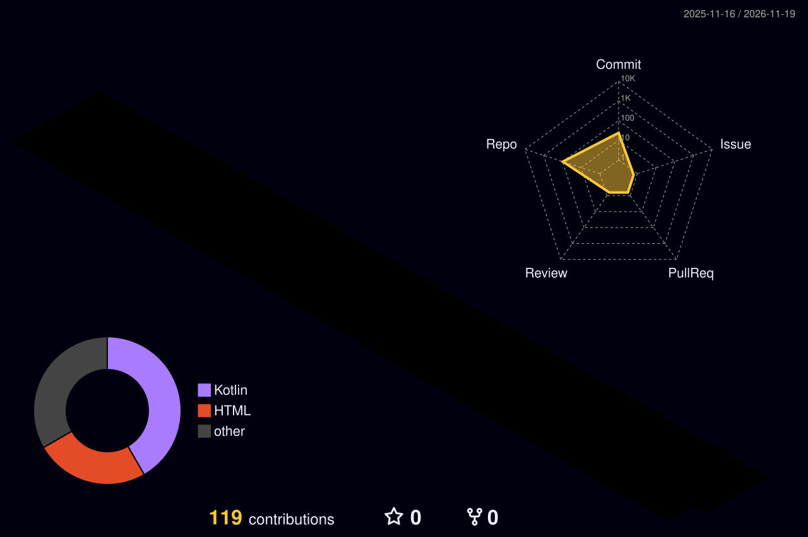

<!-- Hero Banner -->

<!-- Developer ID Card -->

---

### Portfolio

Everything below is built, tested and deployed by me — parking & kiosk systems,
Windows desktop tools, Android apps.

**Live site:** <https://irshrish.github.io/systems-engineer-portfolio/>

---

### 🌃 Contribution City

  

---

  

